
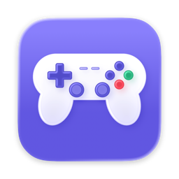

<h1 align="center">Pro3 Mapper</h1>

Gamepad to keys for your Mac · 让手柄在 Mac 上变成键盘和鼠标

  <a href="https://rebas9512.github.io/pro3-mapper/">Support / 技术支持</a> ·
  <a href="https://rebas9512.github.io/pro3-mapper/privacy.html">Privacy Policy / 隐私政策</a> ·
  Mac App Store: coming soon / 即将上架

<a href="#english">English</a> · <a href="#中文">中文</a>

## English

Pro3 Mapper turns your game controller into keyboard and mouse input, so you can play games that don't support controllers. It's made for one controller in particular: a pro-style pad with two back paddles (PL / PR), L4 / R4 buttons under the shoulders and an S / D / X mode switch on the back.

### Map every button
Click a button on the 3D model of the controller, or just press it on the pad, then press a key.

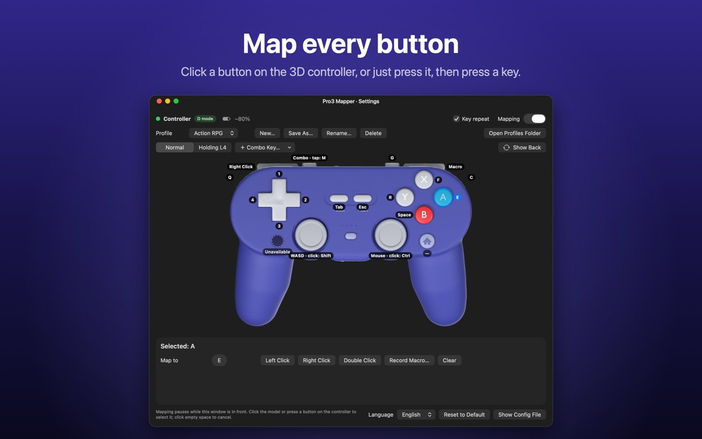

### Combo layers
Hold one button, such as L4, to switch every other button to a second layout. Sticks can change too: the right stick moves the mouse normally and scrolls while L4 is held.

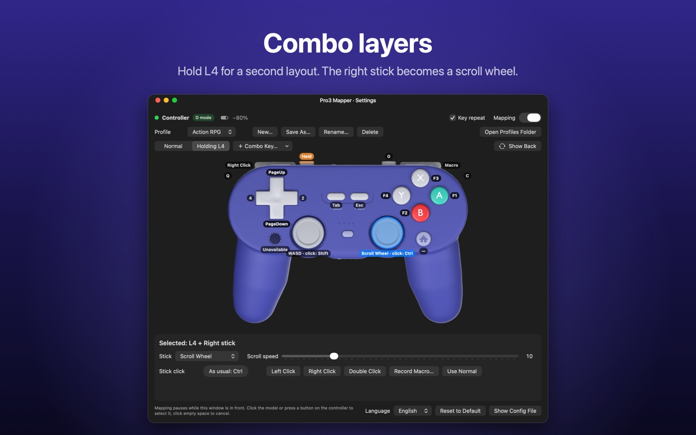

### Macros with real timing
Record keystrokes with their exact timing, edit every step, and play once per press or repeat while held.

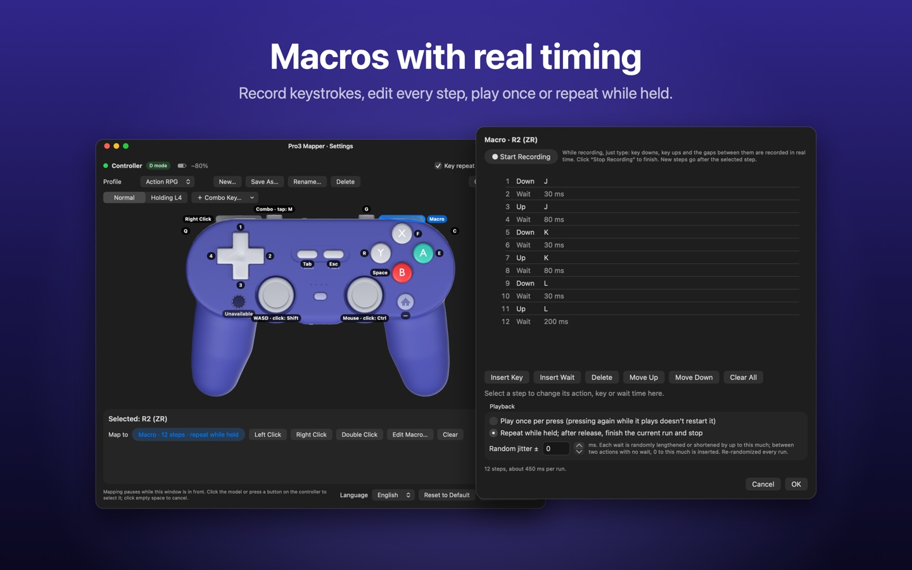

### Back paddles and L4 / R4
Detected automatically in D mode and mapped like any other button.

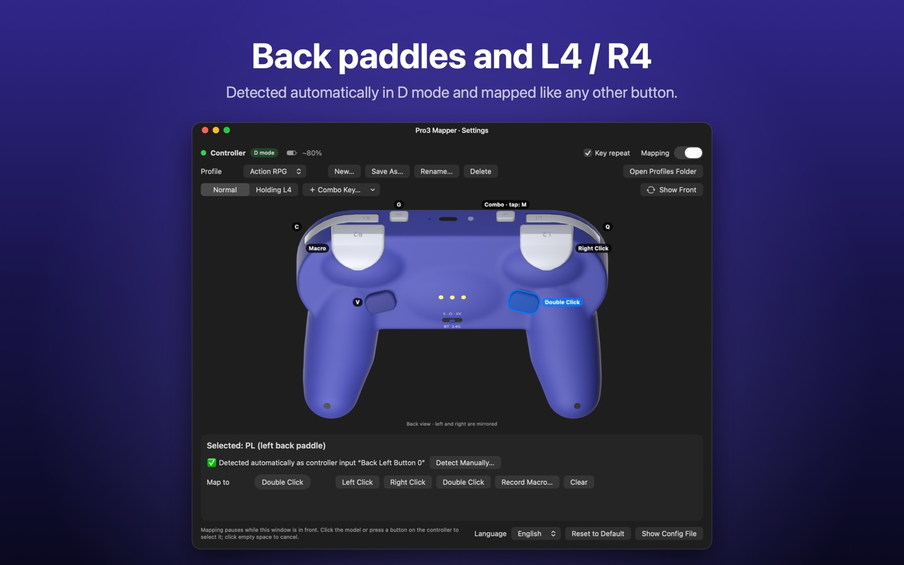

### Sticks your way
WASD, arrow keys, mouse or scroll wheel, with adjustable speed and threshold.

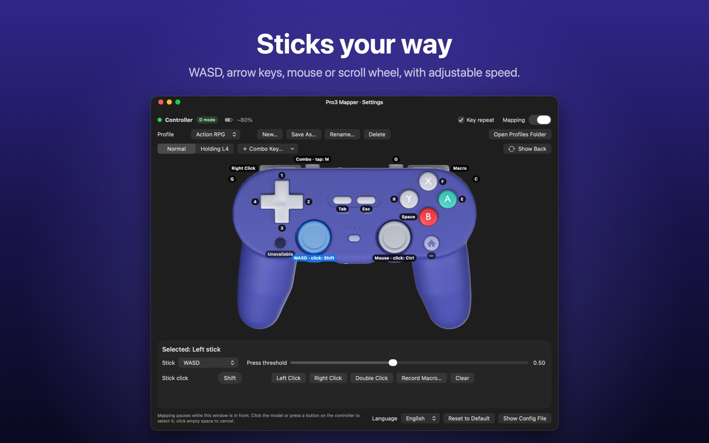

### Also
- Map to keyboard keys, left or right click, double-click, or a macro
- Key repeat that behaves like a real keyboard
- Profiles for different games, switchable from the menu bar
- Knows the controller's modes: D mode (recommended) has every button except Capture; S mode has Capture and HOME but no L4 / R4 / PL / PR; X mode isn't recognized by macOS
- Other controllers that macOS recognizes work with their standard buttons
- No data collected, no network connections
- English and Simplified Chinese · macOS 13 or later

## 中文

Pro3 手柄映射把游戏手柄的按键转成键盘和鼠标输入，让不支持手柄的游戏也能用手柄玩。它是专门为一款手柄打造的：背面有 PL / PR 两个背键，肩键下面有 L4 / R4 小键，背面有 S / D / X 模式开关。

### 每个键都能映射
点 3D 手柄模型上的键，或者直接按一下实体手柄，再按键盘就设好了。

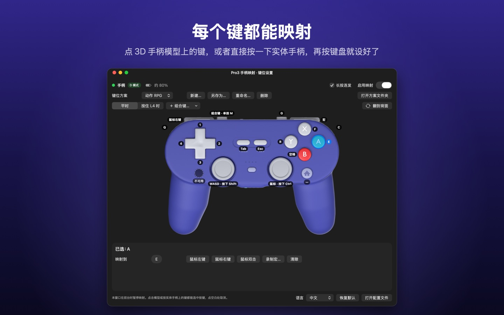

### 组合键，一键换一整套键位
按住一个键（比如 L4），其他键整套换成第二套键位；摇杆也能换，右摇杆平时移动鼠标，按住 L4 时变成滚轮。

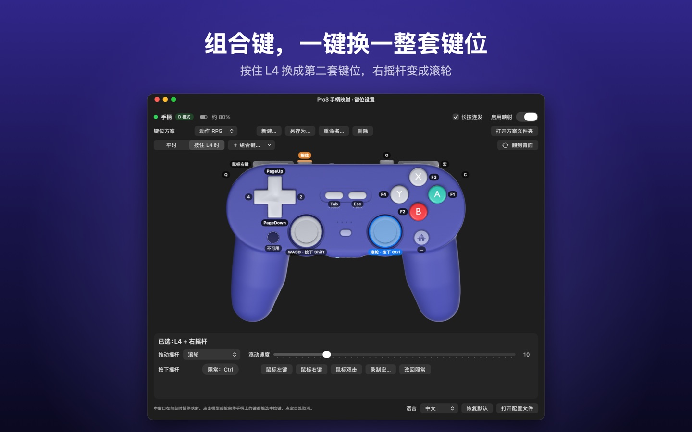

### 按真实节奏录制的宏
录下键盘操作，每一步都能改；按一下放一遍，或者按住一直重复。

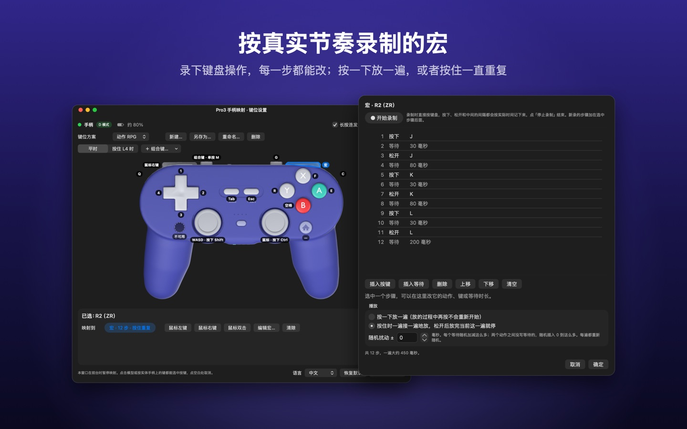

### 背键和 L4 / R4
D 模式下自动识别，和其他键一样映射。

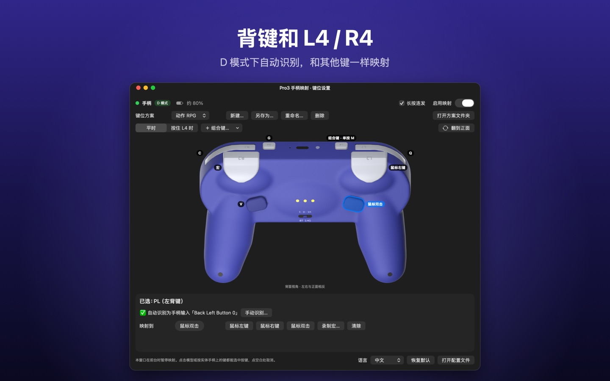

### 摇杆随你设置
WASD、方向键、鼠标或滚轮，速度和灵敏度都能调。

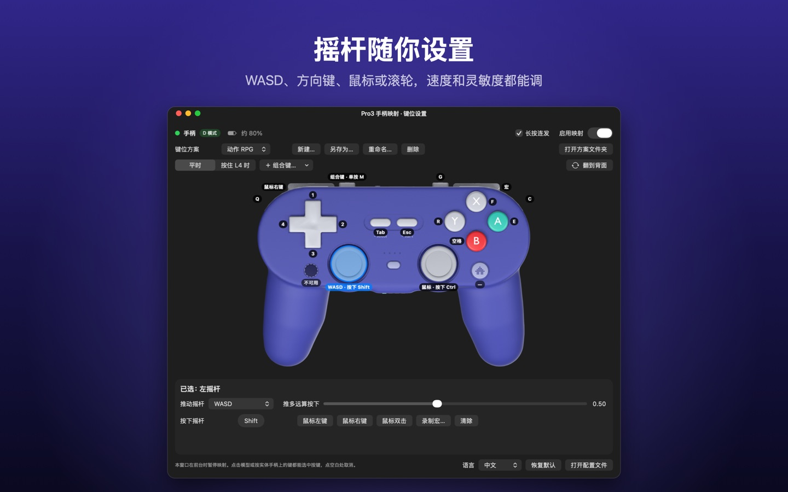

### 其他
- 可以映射成键盘按键、鼠标左键 / 右键、鼠标双击，或者一段宏
- 长按连发和真键盘一样
- 不同游戏用不同的键位方案，在菜单栏里就能切换
- 认得手柄的连接模式：D 模式（推荐）除了截图键都能用；S 模式截图键、HOME 能用，但没有 L4 / R4 / PL / PR；X 模式 macOS 不认
- macOS 认得的其他手柄也能用，支持标准按键
- 不收集任何数据，不联网
- 中文、英文界面 · macOS 13 及以上
